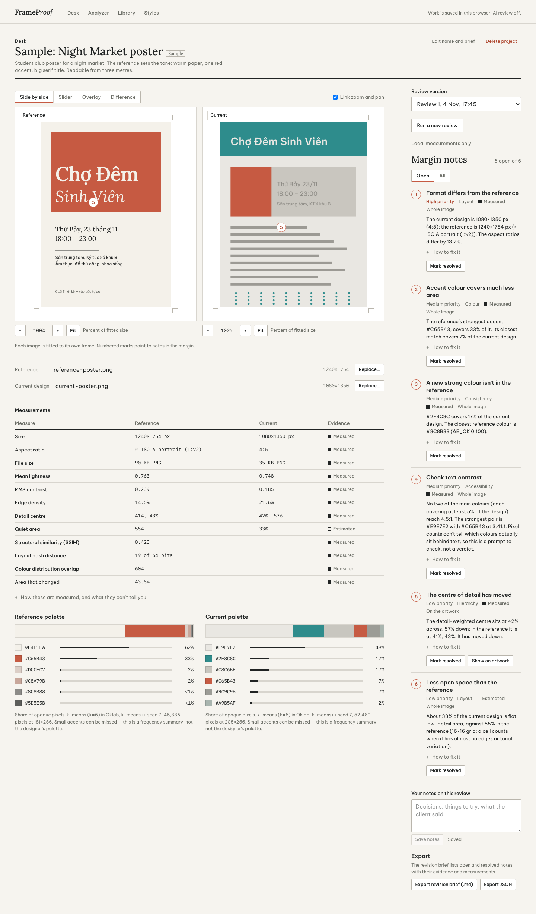

# FrameProof

**Design with intention.** FrameProof is a creative-direction and visual-QA workspace. Pair a design you admire with the one you are making; FrameProof measures both in your browser, shows where they differ, and turns that into a revision brief you can act on.

**Try it:** https://lapisluong.github.io/frameproof/ — the full app as static files on GitHub Pages. Open the
sample project, or upload two of your own images. Everything you add stays in your browser; nothing is uploaded.
AI review is off in this demo because it needs a server and an API key (see "AI review" below to run it locally).



## What it does

| Workspace                    | What you can do                                                                                                                                                                                                                                    |
| ---------------------------- | -------------------------------------------------------------------------------------------------------------------------------------------------------------------------------------------------------------------------------------------------- |
| **Desk**                     | Projects, recent reviews and analyses, saved styles, a labelled sample project                                                                                                                                                                     |
| **Review** (`/project?id=…`) | Upload a reference and a current design; compare side by side (linked zoom/pan), with a slider, as an overlay, or as a difference map; get prioritised margin notes; mark them resolved; keep notes; keep review versions; export Markdown or JSON |
| **Analyzer**                 | One image: dimensions, aspect ratio, palette with pixel share, colour frequency, WCAG contrast for any palette pair, tonal and structural measures; export; save the palette as a style                                                            |
| **Library**                  | Save references (link, image, credit, category, tags, collection, notes); search and filter; open the original; send the image to the analyzer                                                                                                     |
| **Styles**                   | Palette, typography, layout principles, spacing and radius tokens, motion notes, linked references; export JSON tokens and CSS variables                                                                                                           |

### Evidence, not scores

Every finding says what kind of evidence it rests on:

- **Measured** — computed from pixels with a stated method; reproducible.
- **Estimated** — computed, but the interpretation relies on an assumption (e.g. "quiet area").
- **AI-observed** — a vision model's judgement; only appears when AI review is configured.

Each note states what's wrong, why it matters, what to change, and what to keep. There is no composite "design score" — on purpose.

## Quick start (macOS / VS Code)

Requirements: **Node.js 20.9+** (tested with Node 22 and 24), npm 10+.

```bash
git clone https://github.com/LapisLuong/frameproof.git
cd frameproof
npm install
npm run dev          # http://localhost:3000
```

Open the folder in VS Code (`File → Open Folder…`). Recommended extensions: ESLint, Tailwind CSS IntelliSense.

| Script                        | What it runs                                                                                                                  |
| ----------------------------- | ----------------------------------------------------------------------------------------------------------------------------- |
| `npm run dev`                 | Next.js dev server                                                                                                            |
| `npm run build` / `npm start` | Production build / server                                                                                                     |
| `npm run typecheck`           | `tsc --noEmit` (strict, `noUncheckedIndexedAccess`)                                                                           |
| `npm run lint`                | ESLint flat config (`eslint-config-next` core-web-vitals + TypeScript)                                                        |
| `npm test`                    | Vitest unit tests (analysis engine, validation, review rules, AI layer)                                                       |
| `npm run test:e2e`            | Playwright end-to-end tests (run `npx playwright install chromium` once)                                                      |
| `npm run build:static`        | Static files for GitHub Pages in `out/` (no AI route). Set `NEXT_PUBLIC_BASE_PATH=/frameproof` when serving from a sub-folder |
| `npm run samples`             | Regenerates the two sample posters in `public/samples/`                                                                       |
| `npm run record:ai`           | With AI on and `npm run dev` running: records one real AI review of the sample as `tests/fixtures/ai-review.json`             |

### Hướng dẫn nhanh (tiếng Việt)

1. Cài Node.js 20.9 trở lên.
2. `npm install`, sau đó `npm run dev`, rồi mở http://localhost:3000.
3. Bấm **Open the sample project** để xem một bản review hoàn chỉnh, hoặc tạo project mới, kéo thả ảnh tham chiếu và ảnh thiết kế hiện tại.
4. Muốn bật AI review: sao chép `.env.example` thành `.env.local`, điền `AI_PROVIDER` và API key, rồi khởi động lại. Key chỉ nằm ở server, không bao giờ gửi xuống trình duyệt.

## AI review (optional)

FrameProof is fully usable without AI. To add a vision model's second opinion:

```bash
cp .env.example .env.local
# AI_PROVIDER=anthropic and ANTHROPIC_API_KEY=...   (model defaults to claude-sonnet-5-5; override with AI_MODEL)
# or AI_PROVIDER=openai, OPENAI_API_KEY=..., AI_MODEL=<a vision model id>
# With a private key, bind the app to this computer only:
npm run dev -- --hostname 127.0.0.1
```

No paid key? Google's Gemini API has a free tier and an OpenAI-compatible endpoint. Create a key at
https://aistudio.google.com/apikey and use the Gemini block in `.env.example` (`AI_PROVIDER=openai`,
`OPENAI_BASE_URL=https://generativelanguage.googleapis.com/v1beta/openai/`, a vision-capable `AI_MODEL`). On the free
tier Google may use what you send to improve its products, so don't send client work you can't share.

- Review and direction calls run on the server. Put a scoped [OpenAI project key](https://developers.openai.com/api/docs/guides/api-keys) in `.env.local`; never use a `NEXT_PUBLIC_` variable for a key. Leave `OPENAI_BASE_URL` unset for OpenAI.
- For another compatible service, use a key issued by that service and an HTTPS endpoint. HTTP is allowed only on loopback for local testing. Provider requests do not follow redirects.
- Images are re-validated, metadata-stripped and downscaled to 1280 px with sharp before being sent.
- The model receives the brief and the _measured_ facts, and must answer with a strict JSON schema (Zod). Invalid output is retried once, then the review is marked "failed" — nothing is invented.
- When AI is off, the UI says so and the API returns `503 not-configured`.
- To keep a real answer as a test fixture, run `npm run record:ai` while `npm run dev` is running with a key. It drives the
  app on the sample project, saves the validated answer (no key) to `tests/fixtures/ai-review.json` and a screenshot to
  `qa/screenshots/08-ai-review-1440.png`; `tests/unit/ai-fixture.test.ts` then checks it without a key or a network call.
- GitHub Pages has no AI server. Before enabling a paid key on a hosted Node deployment, protect both AI routes with authenticated access and per-user usage limits. Browser origin checks are not authentication.

## Privacy and storage

- Projects, images, reviews, references and styles are stored **in your browser** (IndexedDB). Nothing is uploaded unless you run AI review.
- Clearing site data or using another browser means starting fresh. Export reviews and styles to keep them.
- Uploads are checked by magic bytes (PNG, JPEG, WebP, GIF), limited to 15 MB, and their header dimensions are checked against a 40-megapixel cap before decoding.
- Library links are stored as links only; FrameProof never scrapes or copies pages. Only `http(s)` links are rendered.

## Project layout

```
src/
  app/                 routes: / (Desk), /project?id=, /analyze, /library, /styles, /api/review
  components/          CompareStage, ImageViewer, ProofNotes, Measurements, Dropzone, ...
  hooks/               useStore (IndexedDB + change events), useAiStatus
  lib/
    analysis/          pixels, palette (k-means in Oklab), structure (Sobel), similarity (SSIM, dHash)
    color/             sRGB/Oklab conversion, WCAG contrast
    image/             upload validation, browser decoding
    review/            rule engine, issue schema, Markdown/JSON/CSS exporters
    ai/                provider abstraction (Anthropic, OpenAI-compatible), strict schema
    store/             IndexedDB wrapper, models, repository
tests/unit, tests/e2e  Vitest and Playwright
docs/                  ART_DIRECTION.md, ARCHITECTURE.md, QA.md
```

See [AGENTS.md](AGENTS.md) for product rules, commands, the code map and open work. See [BRAND.md](BRAND.md) for the Lápis signature and app icons.

See [docs/ARCHITECTURE.md](docs/ARCHITECTURE.md) for data flow and decisions, [docs/ART_DIRECTION.md](docs/ART_DIRECTION.md) for the three directions and why "Galley proof" was chosen, and [docs/QA.md](docs/QA.md) for test results and known limitations.

## Credits

- Fonts, self-hosted from `src/app/fonts/` under the SIL Open Font License 1.1: Be Vietnam Pro (© 2021 The Be Vietnam Pro Project Authors), Lora (© 2011 The Lora Project Authors), IBM Plex Mono (© 2017 IBM Corp.). Licence texts are in `src/app/fonts/`.
- Oklab colour space: Björn Ottosson. SSIM: Wang, Bovik, Sheikh & Simoncelli (2004).
- Sample posters in `public/samples/` were made for this project.

Licensed under the MIT License — see [LICENSE](LICENSE).
